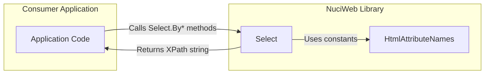
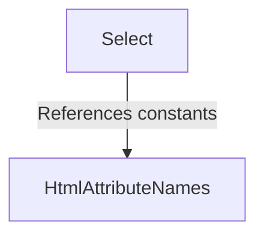
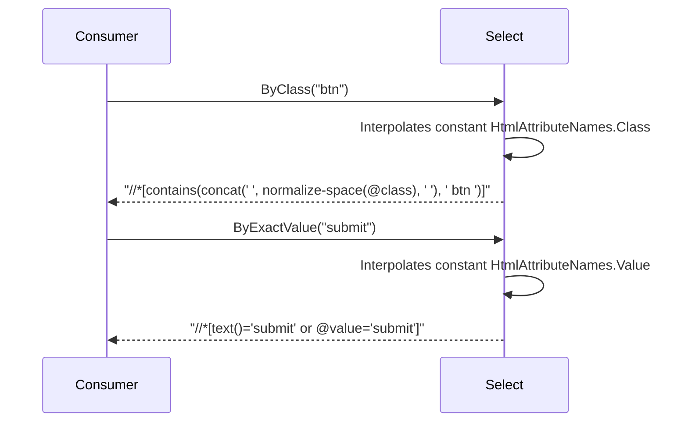
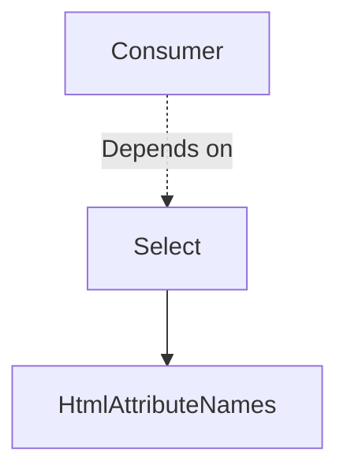

# NuciWeb Architecture

This document describes the current architecture of the NuciWeb library, a .NET library providing XPath selector builders for HTML elements.

## 📑 Table of Contents

- [Purpose](#-purpose)
- [System Context](#-system-context)
- [Architectural Style](#-architectural-style)
- [Runtime Flow](#-runtime-flow)
- [Components](#-components)
- [Dependency Direction and Rules](#-dependency-direction-and-rules)
- [External Dependencies](#-external-dependencies)
- [Deployment and Operations](#-deployment-and-operations)
- [Compatibility Contracts](#-compatibility-contracts)
- [Testing and Verification](#-testing-and-verification)
- [Design Constraints](#-design-constraints)

## 🎯 Purpose

NuciWeb is a .NET library that provides a fluent, type-safe API for constructing XPath expressions targeting HTML elements. It targets developers building web scraping, test automation, or HTML transformation tools who need reliable, maintainable XPath generation without string concatenation errors. The library exposes static factory methods for common selector patterns (class, ID, name, exact value, partial value) and a pass-through for raw XPath.

## 🌐 System Context



The principal external boundaries are:
- **Consumer Application:** Calls `Select` static methods with string parameters; receives XPath strings. No shared state, no callbacks, no lifecycle coupling.
- **HTML Document (External):** The XPath strings are evaluated against an external HTML document (e.g., via `HtmlAgilityPack`, `AngleSharp`, or browser automation). NuciWeb does not parse or load HTML.

## 🏗️ Architectural Style

**Static Utility Library** — The library consists exclusively of `static` classes with pure functions. No instance state, no dependency injection, no runtime composition. This style ensures:
- Zero allocation overhead beyond the returned string.
- Thread safety by default.
- Trivial testing: every method is a pure function `string → string`.
- No versioning conflicts when embedded in larger applications.



The principal architecture boundaries are:
- **Public API Surface (`Select`):** All public entry points. Consumers depend only on this class.
- **Internal Constants (`HtmlAttributeNames`):** Implementation detail. Not intended for direct consumer use, but `public` to allow `Select` to reference it without `internal` assembly coupling.

## 🔄 Runtime Flow



The principal runtime sequence is:
1. Consumer invokes a `Select.By*` method with a string argument.
2. Method interpolates the argument and the relevant `HtmlAttributeNames` constant into an XPath template.
3. Method returns the composed XPath string.
4. Consumer passes the string to an HTML parser or automation driver.

## 🧩 Components

| Component | Responsibility | Principal Dependencies | Lifetime or Ownership |
|-----------|----------------|------------------------|-----------------------|
| `Select` | Public API: factory methods for XPath selectors (`ByXPath`, `ByClass`, `ById`, `ByName`, `ByExactValue`, `ByPartialValue`). | `HtmlAttributeNames` (constants) | Static, stateless, owned by NuciWeb assembly |
| `HtmlAttributeNames` | Centralised HTML attribute name constants (`class`, `href`, `id`, `name`, `src`, `style`, `value`). | None | Static, stateless, owned by NuciWeb assembly |

## 🧭 Dependency Direction and Rules



The principal dependency rules are:
- `Select` depends on `HtmlAttributeNames` (internal constant reuse).
- Consumers depend only on `Select`.
- No external dependencies from the library code.
- No circular dependencies.

## 📦 External Dependencies

| Dependency | Responsibility | Integration Boundary | Architectural Consequence |
|------------|----------------|----------------------|---------------------------|
| `System.Runtime` | Base class library types (`string`, etc.) | Implicit, framework-provided | None; part of .NET 10.0 target framework |

No third-party NuGet packages are referenced by the library project. The test project references NUnit, Moq, and coverlet.collector, but these are excluded from the library artifact (`IsPackable=false`).

## 🚀 Deployment and Operations

| Concern | Current Design | Architectural Consequence |
|---------|----------------|---------------------------|
| **Distribution** | Not packaged (`IsPackable=false` in `NuciWeb.csproj`). Intended as a project reference or source inclusion. | No NuGet versioning, no semantic versioning contract for consumers. |
| **Target Framework** | `net10.0` only. | Requires .NET 10 runtime. No multi-targeting. |
| **Runtime Requirements** | None beyond .NET 10 BCL. | Zero native dependencies, no platform-specific code. |
| **Build** | `dotnet build` from solution root. | Standard SDK-style build. |

## 🛡️ Compatibility Contracts

| Contract | Owner | Invariant | Verification | Change Policy |
|----------|-------|-----------|--------------|---------------|
| `Select.ByXPath(string)` | `Select` | Returns input unchanged. | Unit test `GivenSelect_WhenByXPathWithValidXPath_ThenReturnsSameXPath` | Breaking change requires major version if packaged. |
| `Select.ByClass(string)` | `Select` | Returns XPath matching elements whose `class` attribute contains the argument as a space-separated token. | Unit test `GivenSelect_WhenByClassWithValidName_ThenReturnsCorrectXPath` | Template changes are breaking. |
| `Select.ById(string)` | `Select` | Returns XPath matching element with exact `id` attribute. | Unit test `GivenSelect_WhenByIdWithValidId_ThenReturnsCorrectXPath` | Template changes are breaking. |
| `Select.ByName(string)` | `Select` | Returns XPath matching elements with exact `name` attribute. | Unit test `GivenSelect_WhenByNameWithValidName_ThenReturnsCorrectXPath` | Template changes are breaking. |
| `Select.ByExactValue(string)` | `Select` | Returns XPath matching elements with exact `text()` or `value` attribute. | Unit tests (to be added) | Template changes are breaking. |
| `Select.ByPartialValue(string)` | `Select` | Returns XPath matching elements containing argument in `text()` or `value` attribute. | Unit tests (to be added) | Template changes are breaking. |
| `HtmlAttributeNames.*` constants | `HtmlAttributeNames` | Values match HTML spec attribute names (`class`, `href`, `id`, `name`, `src`, `style`, `value`). | Unit tests in `HtmlAttributeNamesTests` | Changing a constant value is breaking for `Select` output. |

## ✅ Testing and Verification

The solution contains two projects:
- **NuciWeb** — Library, no tests.
- **NuciWeb.UnitTests** — NUnit 4 test project covering all public `Select` methods and `HtmlAttributeNames` constants.

Execute the principal automated verification with:

```bash
dotnet test
```

Test boundaries:
- **Unit tests** verify each `Select` method returns the exact expected XPath string for given inputs (including empty strings).
- **No integration tests** — the library has no external integrations.
- **Coverage** — coverlet.collector configured; `ExcludeFromCodeCoverage=true` on test project.

Material coverage gaps:
- `ByExactValue` and `ByPartialValue` currently have no dedicated unit tests (only the older methods are covered).

## ⚠️ Design Constraints

- **No HTML parsing or evaluation** — The library only *generates* XPath strings. Correctness of the XPath against a specific HTML document is the consumer's responsibility.
- **No escaping** — Input strings are interpolated directly into XPath. Consumers must ensure values do not contain single quotes (`'`) or other characters that would break the XPath syntax.
- **Single target framework** — `net10.0` only. No `netstandard`, `net8.0`, or other TFMs.
- **No packing** — `IsPackable=false` prevents accidental NuGet publication. Distribution is via project reference or source copy.
- **Static-only API** — No extensibility points, no virtual methods, no interfaces. Consumers cannot substitute or extend selector logic.