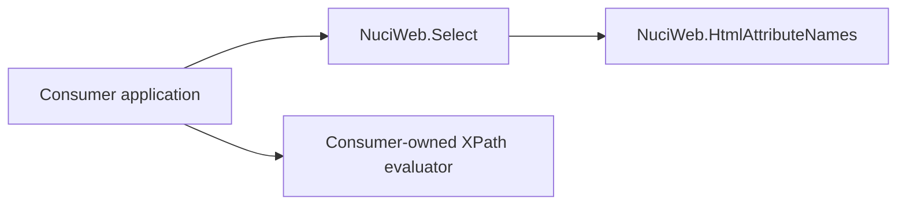

# Architecture

This document complements the root [ARCHITECTURE.md](../ARCHITECTURE.md) with implementation-oriented boundaries.

## Style

NuciWeb is a static utility library. Production code consists of two static classes with pure, synchronous methods. There is no dependency injection, object lifecycle, mutable shared state, callback, or service host.

## Dependency direction

`Select` owns selector construction. `HtmlAttributeNames` centralises attribute spelling. The consumer owns HTML acquisition and XPath evaluation. The library has no dependency on a browser driver or HTML parser.

## Execution contract

1. The consumer calls a static `Select` method with a string.
2. The method selects a fixed XPath template.
3. The method interpolates the supplied value and, where needed, an attribute-name property.
4. The method returns the expression without evaluating it.
5. The consumer passes the expression to its own evaluator.

`ByXPath` is the pass-through path and returns its input unchanged. The value-based methods produce predicates over `text()` and/or `@value`; `ByClass` uses whitespace-normalised token matching.

## Failure boundary

The library performs no input validation or XPath escaping. A caller-provided quote can therefore produce an expression that is syntactically invalid or semantically different from the caller's intention. XPath evaluation errors occur outside this library because evaluation is consumer-owned.

## Change impact

Changes to attribute names affect all selector templates that reference them. Changes to template punctuation or predicate structure change the public string-output contract and require corresponding tests. Changes to public method signatures affect every consumer directly.