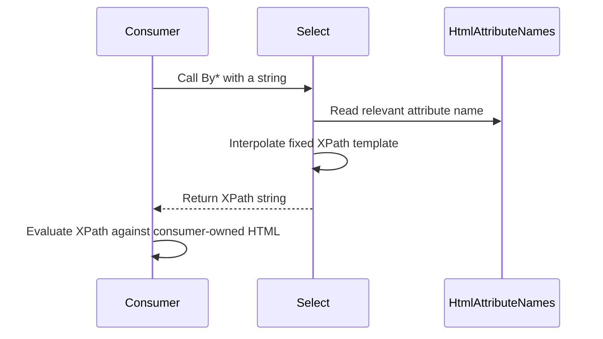

# Selector construction

## Causal steps

1. The consumer chooses a selector method based on the HTML attribute or text requirement.
2. The method reads the relevant static attribute-name property when one is needed.
3. The method interpolates the caller's string into a fixed XPath template.
4. The method returns the string without I/O or evaluation.
5. The consumer evaluates it using its own parser or automation framework.

The library's responsibility ends at step 4. Invalid syntax, no matches, and evaluator exceptions are outside the library boundary.